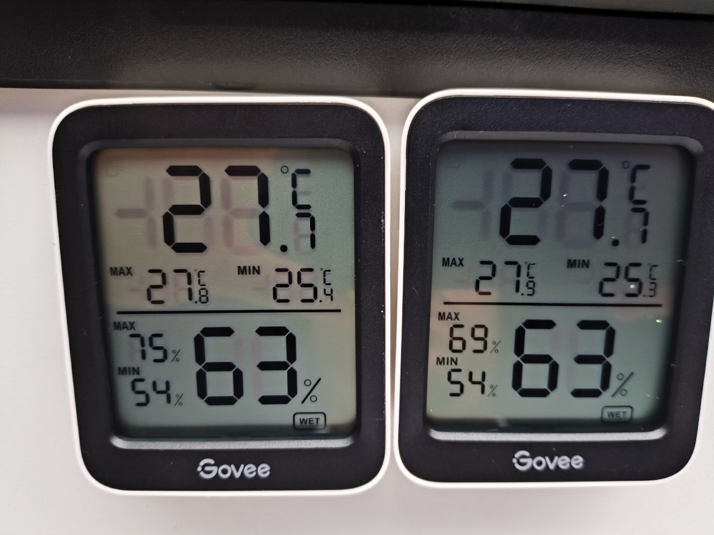

# Termohigrómetros Bluetooth H5075 en un MikroTik KNOT

[🇬🇧 English](README.md) · 🇪🇸 Español

Lee la temperatura, la humedad y la batería de los termohigrómetros Bluetooth H5075
con un **MikroTik KNOT** (RouterOS 7) que actúa como escáner BLE. Un script decodifica
cada anuncio y escribe los valores en el log del router cada 5 segundos. Los sensores
emiten sus lecturas en anuncios sin cifrar, por lo que el KNOT no necesita emparejamiento
ni conexión.

**Autor:** Victor Bolaños Guerra

---

## Contenido

| Ruta | Descripción |
|---|---|
| `h5075-reader.rsc` | Script de RouterOS que decodifica los anuncios y escribe los valores en el log |
| `ble-setup.rsc` | Configuración de la lista blanca y del escáner para los sensores |
| `scheduler-setup.rsc` | Entrada del programador que ejecuta el lector cada 5 segundos |
| `docs/govee-h5075-user-manual.pdf` | Manual de usuario del Govee H5075 |
| `images/` | Foto de los sensores |

## Flujo de datos

```
Sensores H5075 ──anuncios BLE──► MikroTik KNOT (RouterOS 7, /iot bluetooth scanner)
                                              │  lista blanca: dos MAC de sensores
                                              ▼
                                  h5075-reader.rsc (programador, cada 5 s)
                                              │
                                              ▼
                                  log del sistema (tema: script)
                                  h5075-1: temperature=27.9 C humidity=63.5 % battery=100 % last-seen=...
```

---

## Hardware



| Elemento | Detalles |
|---|---|
| Router | MikroTik KNOT con Bluetooth integrado, RouterOS 7 (probado con el paquete `iot`) |
| Sensores | Termohigrómetro inteligente Govee H5075 (SKU H5075001 / H5075081). Se anuncian como `GVH5075_xxxx` |
| Fabricante | Shenzhen Intellirocks Tech Co., Ltd. (según la información de cumplimiento de la UE del manual) |
| Radio | Bluetooth, alcance de 50 m / 164 ft sin obstáculos. El manual no indica el chip de radio; el prefijo MAC de los sensores `A4:C1:38` está registrado a nombre de Telink Semiconductor en el registro IEEE |
| Precisión | Temperatura ±0,3 °C / ±0,54 °F; humedad ±3 % (según el manual) |
| Rango de funcionamiento | 0 °C a 50 °C (32 °F a 122 °F); humedad del 0 % al 99 % (según el manual) |
| Formato de anuncio | Datos del fabricante, ID de empresa `0xEC88`, sin cifrar |

El manual de usuario oficial se incluye en [`docs/govee-h5075-user-manual.pdf`](docs/govee-h5075-user-manual.pdf). Cubre el dispositivo, la aplicación Govee Home y la conexión Bluetooth.

---

## Formato del anuncio

Los sensores envían sus lecturas en la estructura AD específica del fabricante:

| Bytes (carga útil) | Significado |
|---|---|
| byte 0 | `0x00` en todas las capturas hasta la fecha |
| bytes 1–3 | Valor de 24 bits `V` |
| byte 4 | Nivel de batería (%) |
| byte 5 | Sin uso |

Decodificación a partir de `V`:

- temperatura (°C) = `(V / 1000) / 10`
- humedad (%) = `(V % 1000) / 10`

Ejemplo: la carga útil `00 04 44 53 64 00` da `V = 0x044453 = 279635`, es decir,
27,9 °C, 63,5 % de humedad y 100 % de batería. Los valores coincidían con la pantalla del sensor.

Este formato se dedujo a partir de anuncios capturados y de la ingeniería inversa realizada
por la comunidad con sensores similares. No procede de una especificación del fabricante.

---

## Configuración en el KNOT

1. Añade los sensores a la lista blanca y activa el filtrado. Los comandos completos están en
   [`ble-setup.rsc`](ble-setup.rsc).

   ```
   /iot bluetooth whitelist add address=<mac-del-sensor> address-type=public device=bt1 comment=h5075-1
   /iot bluetooth scanners set bt1 disabled=no filter-policy=whitelist interval=10ms window=10ms
   ```

   `address-type=public` indica al escáner que el sensor usa su dirección asignada de fábrica
   (IEEE), que es la forma en que estos sensores anuncian. La lista blanca solo filtra lo que
   acepta el escáner; no autentica los sensores.

2. Comprueba que llegan los anuncios:

   ```
   /iot bluetooth scanners advertisements print where address=<mac-del-sensor>
   ```

   El campo `data` debería contener `09ff88ec` seguido de seis bytes de carga útil.

3. Instala el script. Sube `h5075-reader.rsc` al router e impórtalo:

   ```
   /import file-name=h5075-reader.rsc
   ```

   Esto crea un script llamado `h5075-reader`. Si la importación le asigna otro nombre, ajusta
   el comando del programador del paso 4.

4. Crea la entrada del programador que ejecuta el lector cada 5 segundos. Los comandos están en
   [`scheduler-setup.rsc`](scheduler-setup.rsc).

   ```
   /system scheduler add name=h5075-reader-sched interval=5s on-event="/system script run h5075-reader"
   ```

5. Lee los valores en el log:

   ```
   /log print where message~"h5075"
   ```

---

## Configuración

Las MAC y los nombres de los sensores se definen al principio de `h5075-reader.rsc`:

```
:local sensors {"A4:C1:38:8B:3D:15"="h5075-1"; "A4:C1:38:01:D9:6E"="h5075-2"}
```

---

## Solución de problemas

| Síntoma | Causa probable |
|---|---|
| No hay anuncios en la lista del escáner | El escáner está desactivado o la MAC del sensor no está en la lista blanca |
| La lista del escáner muestra la MAC pero no los datos `09ff88ec` | Firmware o modelo distinto; el formato de la carga útil puede variar |
| Los valores no coinciden con la pantalla | Modelo o firmware de sensor distinto; revisa el formato de la carga útil |
| No aparecen líneas en el log | El programador no se ha creado o el nombre del script no es `h5075-reader` |

---

## Notas y limitaciones

- Las temperaturas negativas todavía no se decodifican.
- El script no filtra las lecturas antiguas. El campo `last-seen` muestra la hora del anuncio, así que una diferencia entre esa hora y la del log indica una lectura antigua.
- La precisión no se ha comparado todavía con un termómetro de referencia calibrado.

---

## Fuentes

- [Manual de usuario del Govee H5075](docs/govee-h5075-user-manual.pdf) (incluido en este repositorio)
- [Documentación de Bluetooth de RouterOS (`/iot bluetooth`)](https://help.mikrotik.com/docs/spaces/ROS/pages/78086201/Bluetooth)
