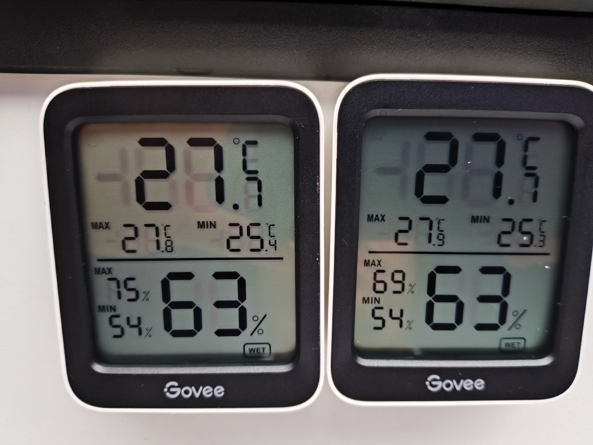

# H5075 Bluetooth thermo-hygrometers on a MikroTik KNOT

🇬🇧 English · [🇪🇸 Español](README.es.md)

Read temperature, humidity and battery from H5075 Bluetooth thermo-hygrometers
with a **MikroTik KNOT** (RouterOS 7) acting as a BLE scanner. A script decodes
each advertisement and writes the values to the router log every 5 seconds.
The sensors broadcast their readings in unencrypted advertisements, so the KNOT
needs no pairing or connection.

**Author:** Victor Bolaños Guerra

---

## Contents

| Path | Description |
|---|---|
| `h5075-reader.rsc` | RouterOS script that decodes the advertisements and writes the values to the log |
| `ble-setup.rsc` | Whitelist and scanner configuration for the sensors |
| `scheduler-setup.rsc` | Scheduler entry that runs the reader every 5 seconds |
| `docs/govee-h5075-user-manual.pdf` | Govee H5075 user manual |
| `images/` | Photo of the sensors |

## Data flow

```
H5075 sensors ──BLE advertisements──► MikroTik KNOT (RouterOS 7, /iot bluetooth scanner)
                                              │  whitelist: two sensor MACs
                                              ▼
                                  h5075-reader.rsc (scheduler, every 5 s)
                                              │
                                              ▼
                                  system log (topic: script)
                                  h5075-1: temperature=27.9 C humidity=63.5 % battery=100 % last-seen=...
```

---

## Hardware



| Item | Details |
|---|---|
| Router | MikroTik KNOT with built-in Bluetooth, RouterOS 7 (tested with the `iot` package) |
| Sensors | Govee H5075 Smart Thermo-Hygrometer (SKU H5075001 / H5075081). They advertise as `GVH5075_xxxx` |
| Manufacturer | Shenzhen Intellirocks Tech Co., Ltd. (per the EU compliance information in the manual) |
| Radio | Bluetooth, 50 m / 164 ft range without obstacles. The manual does not name the radio chip; the sensors' MAC prefix `A4:C1:38` is registered to Telink Semiconductor in the IEEE registry |
| Accuracy | Temperature ±0.3 °C / ±0.54 °F; humidity ±3 % (manual) |
| Operating range | 0 °C to 50 °C (32 °F to 122 °F); humidity 0 % to 99 % (manual) |
| Advertising format | Manufacturer data, company ID `0xEC88`, unencrypted |

The official user manual is included in [`docs/govee-h5075-user-manual.pdf`](docs/govee-h5075-user-manual.pdf). It covers the device, the Govee Home app and the Bluetooth connection.

---

## Advertisement format

The sensors send their readings in the manufacturer-specific AD structure:

| Bytes (payload) | Meaning |
|---|---|
| byte 0 | `0x00` in every capture so far |
| bytes 1–3 | 24-bit value `V` |
| byte 4 | battery level (%) |
| byte 5 | unused |

Decoding from `V`:

- temperature (°C) = `(V / 1000) / 10`
- humidity (%) = `(V % 1000) / 10`

Example: payload `00 04 44 53 64 00` gives `V = 0x044453 = 279635`, which is
27.9 °C, 63.5 % humidity and 100 % battery. The values matched the sensor's display.

This format was derived from captured advertisements and community reverse
engineering of similar sensors. It is not from a manufacturer specification.

---

## Setup on the KNOT

1. Add the sensors to the whitelist and enable filtering. Full commands are in
   [`ble-setup.rsc`](ble-setup.rsc).

   ```
   /iot bluetooth whitelist add address=<sensor-mac> address-type=public device=bt1 comment=h5075-1
   /iot bluetooth scanners set bt1 disabled=no filter-policy=whitelist interval=10ms window=10ms
   ```

   `address-type=public` tells the scanner that the sensor uses its factory-assigned
   (IEEE) address, which is how these sensors advertise. The whitelist only filters what
   the scanner accepts; it does not authenticate the sensors.

2. Check that advertisements arrive:

   ```
   /iot bluetooth scanners advertisements print where address=<sensor-mac>
   ```

   The `data` field should contain `09ff88ec` followed by six payload bytes.

3. Install the script. Upload `h5075-reader.rsc` to the router and import it:

   ```
   /import file-name=h5075-reader.rsc
   ```

   This creates a script named `h5075-reader`. If the import names it differently, adjust
   the scheduler command in step 4.

4. Create the scheduler entry that runs the reader every 5 seconds. The commands are in
   [`scheduler-setup.rsc`](scheduler-setup.rsc).

   ```
   /system scheduler add name=h5075-reader-sched interval=5s on-event="/system script run h5075-reader"
   ```

5. Read the values in the log:

   ```
   /log print where message~"h5075"
   ```

---

## Configuration

Sensor MACs and names are defined at the top of `h5075-reader.rsc`:

```
:local sensors {"A4:C1:38:8B:3D:15"="h5075-1"; "A4:C1:38:01:D9:6E"="h5075-2"}
```

---

## Troubleshooting

| Symptom | Likely cause |
|---|---|
| No advertisements in the scanner list | Scanner disabled, or the sensor MAC is not in the whitelist |
| Scanner list shows the MAC but no `09ff88ec` data | Different firmware or model; the payload format may differ |
| Values do not match the display | Different sensor model or firmware; check the payload format |
| No lines in the log | Scheduler not created, or the script name differs from `h5075-reader` |

---

## Notes and limitations

- Negative temperatures are not decoded yet.
- Stale readings are not filtered by the script. The `last-seen` field shows the advertisement time, so a gap between it and the log timestamp indicates an old reading.
- Accuracy has not been compared with a calibrated reference thermometer.

---

## Sources

- [Govee H5075 user manual](docs/govee-h5075-user-manual.pdf) (included in this repository)
- [RouterOS Bluetooth (`/iot bluetooth`) documentation](https://help.mikrotik.com/docs/spaces/ROS/pages/78086201/Bluetooth)
